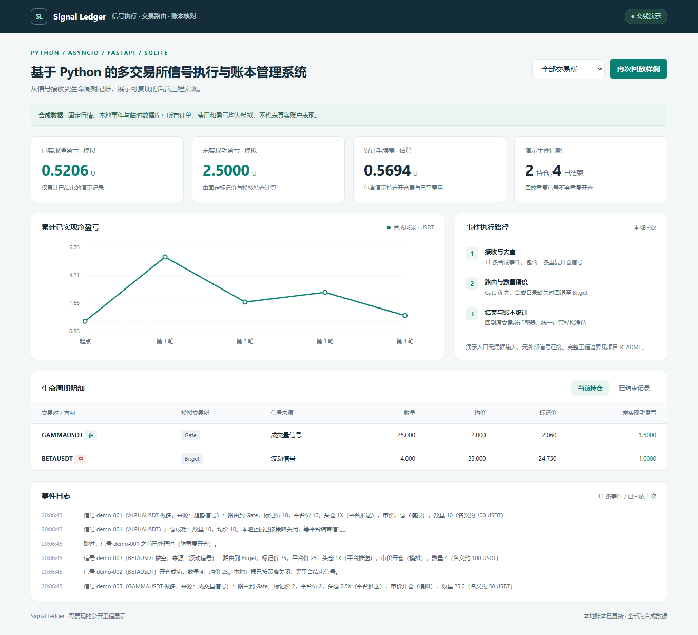
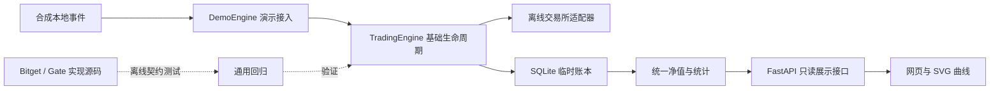

# 基于 Python 的多交易所信号执行与账本管理系统

一个以信号生命周期、交易所适配和账本一致性为核心的 Python 工程项目。使用 FastAPI 提供接口和网页，使用 asyncio 处理异步任务，使用 SQLite 保存状态，使用 Decimal 处理数量与金额。

本仓库由一个持续维护的项目原型整理而来。公开版提供**无需 API Key、无需外部信号服务的离线演示**，便于阅读源码、复现场景和讨论设计。项目不生成买卖建议，也不承诺投资收益。



## 快速体验

需要 Python 3.11 或更新版本。以下命令在仓库根目录执行：

```bash
python -m venv .venv
# Windows PowerShell
.\.venv\Scripts\Activate.ps1
# macOS / Linux 则使用：source .venv/bin/activate
python -m pip install -r requirements.lock
python -m signal_ledger
```

用浏览器打开 `http://127.0.0.1:8877`。安装依赖需要联网；安装完成后的演示只使用回环网络，不访问外部行情、信号平台或交易账户。

若端口占用，可执行 `python -m signal_ledger --port 8878`。按 Ctrl+C 停止；演示数据库由程序创建在系统临时目录，正常退出时删除，重启后重新生成合成样例。

也可以只运行命令行回放或离线检查：

```bash
python -m signal_ledger.demo
python tools/check.py
```

## 可以看到什么

初始回放包含 11 条合成事件：6 个不同信号、1 条重复开仓事件、4 条结束事件。回放后保留 2 个模拟持仓与 4 条已结束记录；获利与亏损样例同时存在。

- **幂等处理**：相同信号 ID 不重复开仓，再次回放不会新增订单或重复累计净值。
- **交易所路由**：在合成合约目录中优先选择 Gate，目录缺失时回退至 Bitget；结束记录仍使用原交易所适配器。
- **数量计算**：按名义价值与价格计算数量，再按合约步进处理；不使用二进制浮点数计算账本金钱。
- **生命周期账本**：展示开仓数量、均价、结束价格、估算费用、已实现净值和未实现毛盈亏。
- **统计口径**：历史明细、净值曲线和累计净值共用同一净值函数，可按交易所筛选。
- **演示隔离**：无密钥输入、无实盘启动接口、无真实下单路径；入口固定绑定本机回环地址，并限制演示进程的外部网络连接。

页面中的 ALPHA、BETA 等标的、信号来源、订单及盈亏均为人为构造，不能据此推断实盘表现。

## 代码中保留的工程实现

| 范围 | 实现内容 | 公开版验证方式 |
| --- | --- | --- |
| 交易所适配 | Bitget / Gate 请求签名、合约过滤器、成交和账单解析 | 假客户端与离线响应样例 |
| 异步引擎 | 接收与处理分离、断线退避、信号分发、仓位锁 | 通用回归用例；演示采用本地顺序派发 |
| 精度处理 | Decimal、数量步进、Gate 合约面值与小数张换算 | 边界值与离线合约样例 |
| 账本一致性 | 费用去重、区间替换、部分平仓分摊、资金费归属 | 临时 SQLite 数据库与合成账单 |
| 异常处理 | 超时结果未知时停止盲目重试；分页不完整时保留旧账 | 故障注入与重复分页样例 |
| Web 演示 | FastAPI、生命周期资源管理、交易所筛选、原生 SVG 曲线 | API 检查与浏览器验收 |

原始交易所适配器作为工程源码保留，**不由公开演示入口实例化**。它们没有在本次公开版中进行真实账户或当前外部接口的端到端验收。

## 架构



演示接入层负责固定行情、目录路由与资源隔离；原有引擎负责防重复、数量计算及基础状态转换。这样既能复用已有逻辑，也能明确区分模拟验证与外部服务验收。

## 目录

```text
signal_ledger/
  core.py             # 数据库、参数、精度工具与交易所适配实现
  engine.py           # 异步信号引擎与生命周期处理
  demo_runtime.py     # 离线行情、演示适配与临时会话
  network_guard.py    # 演示和测试进程的回环网络限制
  web.py              # 演示应用工厂与 HTTP 接口
  demo.py             # 命令行合成事件回放
  fixtures/           # 人工构造的 JSON 事件
  static/             # 无外部 CDN 的网页
tests/
  regression_cases.py # 从原型抽取的通用回归场景
  test_core_regression.py
  test_demo.py
tools/
  check.py            # 完整公开版检查入口
  public_scan.py      # 常见敏感文件与内容特征扫描
docs/
  architecture.md
  verification.md
  interview.md
```

## 接口

| 方法 | 路径 | 含义 |
| --- | --- | --- |
| GET | `/` | 离线演示页面 |
| GET | `/api/status` | 合成持仓、历史、净值曲线及日志 |
| GET | `/api/status?exchange=gate` | 按模拟交易所筛选；也支持 `bitget` |
| POST | `/api/demo/replay` | 再次回放合成事件，用于检查防重复 |

公开应用不注册凭据设置、实盘启动、真实下单、保证金或杠杆调整接口。

## 验证与边界

`python tools/check.py` 会先扫描公开候选文件，再在临时目录和出站网络限制下运行全部公开测试。测试涉及模拟订单，不消耗交易资金。验证结果与环境见 [验证记录](docs/verification.md)。

目前保留的限制：

1. `core.py`、`engine.py` 仍较大，含历史兼容逻辑；尚未完成数据库、适配器与业务服务的进一步拆分。
2. 原型 WebSocket 接收队列满时会丢弃消息；尚未实现持久化消息队列、崩溃重投与全链路事件追踪。离线演示不证明实盘消息完整性。
3. 模拟费用按固定费率估算，演示不获取真实资金费账单；不能把“模拟费用”当作交易所实际账单。
4. 本次公开测试不构成外部 API 当前兼容性、投资策略有效性或生产安全性的认证。
5. Python 审计限制用于约束专用演示进程，不是针对恶意代码的操作系统级沙箱。

## 来源、贡献与许可

本次公开版的代码整理、离线演示、测试和文档制作使用了 AI 编程助手辅助。项目介绍应如实说明维护者实际参与的设计、实现、验证和修复，不将未参与的工作写成个人独立完成。

本仓库未附带真实账户数据库、历史成交导出、生产日志、内部运维文档或生产服务配置。依赖由包管理器安装，不在仓库中分发依赖源码。

**当前尚未选择开源许可证。** 本仓库用于源码阅读与工程展示，后续由维护者确定最终许可方式；个人贡献和第三方代码来源应按实际情况说明。
